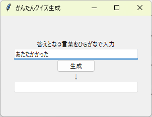
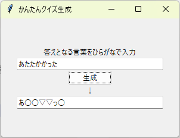
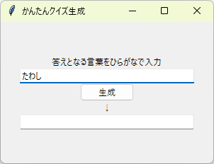
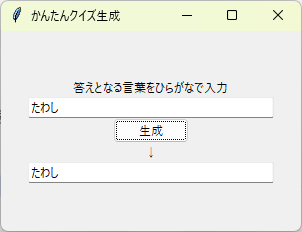

# かんたんクイズ生成ツール

QuizKnockの動画を見て「これPythonで作れそう！」と思って作った趣味ツールです。  
入力したひらがな文字列の重複文字を記号（○とか▽）に置き換えてクイズ化します。

## 主な機能
- ひらがな入力 → 重複文字を自動で記号に変換（例: あたたかかった → あ○○▽▽っ○）\
 
- 重複がない場合は**そのまま表示**（例: たわし → たわし）\
 

## 使い方
1. `quiz_generator.py` を実行
2. GUIが起動するのでひらがな入力 → 「生成」ボタンを押すだけ

## 使った技術
- Python (collections.Counter, tkinter)
- 文字列処理・ロジック検証

## 動機
QuizKnockの動画を見て「これPythonで再現できるのでは？」と思ったので作りました。
文字列処理の練習＋クイズ遊びとして継続中です。

ご覧いただきありがとうございます！
